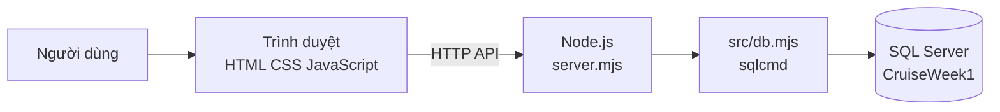

# Aurora Cruise — Hệ thống quản lý du thuyền

Đồ án môn **Hệ quản trị cơ sở dữ liệu**, xây dựng hệ thống quản lý hành trình, đặt chỗ và dịch vụ trên du thuyền Aurora. Ứng dụng kết hợp giao diện web với **SQL Server/T-SQL**: người dùng thao tác trên web, máy chủ xử lý yêu cầu và truy vấn cơ sở dữ liệu.

> Mã nguồn ứng dụng hiện nằm trong [`week1-cruise-foundation/`](week1-cruise-foundation/). Hướng dẫn cài đặt chi tiết, mô tả nghiệp vụ và cấu hình được viết trong [README của ứng dụng](week1-cruise-foundation/README.md).

## Chức năng chính

- Đăng nhập, đăng xuất và phân quyền cho hành khách cùng các nhóm nhân viên.
- Quản lý chuyến đi, tàu, cabin, cảng, lịch trình và thông báo theo chuyến.
- Đặt chỗ, đăng ký hoạt động trên tàu hoặc tour bờ, quản lý danh sách chờ, hủy và hoàn phí theo chính sách.
- Tạo nhóm tour bờ, phân công xe và hướng dẫn viên, theo dõi khách check-in và trở về tàu.
- Hành khách xem mã QR, tài khoản chi phí, giao dịch, hóa đơn, khoản hoàn và gửi tranh chấp.
- POS bán dịch vụ, hỗ trợ hàng đợi ngoại tuyến và đồng bộ giao dịch bằng mã UUID để hạn chế ghi trùng.
- Nhân viên tài chính đối soát giao dịch, xử lý tranh chấp và chốt tài khoản theo các ràng buộc nghiệp vụ.
- Gửi phản hồi sau chuyến đi hoặc hoạt động.

## Công nghệ

- **Cơ sở dữ liệu:** Microsoft SQL Server, T-SQL, khóa chính/khóa ngoại, ràng buộc, stored procedure và transaction.
- **Máy chủ:** Node.js 18 trở lên, dùng `sqlcmd` để kết nối SQL Server.
- **Giao diện:** HTML, CSS và JavaScript thuần; có thiết kế responsive cho màn hình nhỏ.
- **Thư viện:** `qrcode` để tạo mã QR.



## Chạy trên Windows

Cần cài Node.js, SQL Server và `sqlcmd`. Mở PowerShell tại thư mục gốc repository rồi chạy:

```powershell
cd week1-cruise-foundation
npm ci
npm run setup
npm start
```

Mở <http://localhost:3001>. `npm run setup` tạo/cập nhật database `CruiseWeek1` và nạp dữ liệu demo. Nếu dùng SQL Server Express, đặt tên instance trước khi setup và giữ cấu hình đó trong cùng phiên PowerShell:

```powershell
$env:SQL_SERVER = '.\SQLEXPRESS'
```

Có thể xem hướng dẫn cấu hình instance, database và cách chạy bằng SSMS trong [README ứng dụng](week1-cruise-foundation/README.md). **Lưu ý:** trước khi chạy setup trên máy có database quan trọng, hãy kiểm tra đúng SQL Server instance và tên database trong cấu hình.

## Tài khoản demo

Mật khẩu demo: `Aurora123!`

| Vai trò | Email |
|---|---|
| Hành khách | `guest1@demo.local` đến `guest20@demo.local` |
| Điều phối | `itinerary@demo.local` |
| Hoạt động và check-in | `checkin@demo.local` |
| Quản lý tour bờ | `shore@demo.local` |
| Nhân viên POS | `pos@demo.local` |
| Tài chính | `finance@demo.local` |
| Vận hành | `operations@demo.local` |
| Quản trị | `admin@demo.local` |

Chỉ sử dụng tài khoản này cho môi trường demo cục bộ; không dùng mật khẩu demo cho hệ thống thật.

## Database và kiểm tra

- [`01-schema.sql`](week1-cruise-foundation/database/01-schema.sql) tạo các bảng, khóa và quan hệ nền tảng.
- [`03-seed.sql`](week1-cruise-foundation/database/03-seed.sql) nạp dữ liệu mẫu.
- Các migration trong [`database/`](week1-cruise-foundation/database/) bổ sung xác thực, đặt chỗ, hoạt động, POS, tài chính, check-in, tour bờ và các nghiệp vụ khác. [`setup.mjs`](week1-cruise-foundation/scripts/setup.mjs) chạy chúng theo thứ tự.
- [Sơ đồ ERD](week1-cruise-foundation/docs/ERD.md), [từ điển dữ liệu](week1-cruise-foundation/docs/DICTIONARY.md) và [yêu cầu](week1-cruise-foundation/docs/REQUIREMENTS.md) mô tả thêm cấu trúc và nghiệp vụ.

Các lệnh kiểm tra:

```powershell
npm run check
npm run test:auth
npm run test:integrity
npm run test:pos
npm run test:finance
```

Các bài kiểm tra nghiệp vụ tự tạo database riêng rồi xóa sau khi chạy. Chi tiết kiểm thử, POS ngoại tuyến, tài chính hành khách và phân quyền nằm trong thư mục [`week1-cruise-foundation/docs/`](week1-cruise-foundation/docs/).

## Cấu trúc thư mục

```text
week1-cruise-foundation/
├── database/     # Schema, dữ liệu mẫu và migration T-SQL
├── docs/         # ERD, từ điển dữ liệu, yêu cầu và hướng dẫn nghiệp vụ
├── public/       # Giao diện HTML, CSS, JavaScript và service worker
├── scripts/      # Khởi tạo/cập nhật database
├── src/          # Kết nối SQL Server
├── tests/        # Kiểm tra xác thực, toàn vẹn, POS và tài chính
├── server.mjs    # Máy chủ HTTP và API
└── README.md     # Hướng dẫn chi tiết của ứng dụng
```
